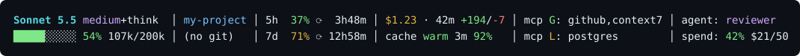

# Useful Claude Statusline

A compact, column-aligned status line for Claude Code: model, context, rate limits, cost, cache, git and MCP in two rows. Needs only Node.js.



## What it shows

Two rows, six columns. "Claude" = value is passed in by Claude Code on stdin ([field reference](https://code.claude.com/docs/en/statusline)).

The screenshot shows every cell filled. In real use some cells are hidden or show `–` when Claude Code doesn't send the data: the 5h/7d limits and cache show `–`; cost, `agent` and `spend` are blank. Col 6 and its separator disappear when both of its cells are blank.

| Col | Row 1 | Row 2 |
|---|---|---|
| **Col 1** | model, effort, `+think`, `⚡fast`<br>Claude: `model`, `effort`, `thinking`, `fast_mode` | context bar, %, used/window<br>Used tokens from Claude (`context_window.current_usage`: input + cache creation + cache read). Window is **not** the model limit; see below |
| **Col 2** | project name (truncated to fit)<br>Claude: `workspace.current_dir` (folder name) | branch, `+staged ~modified ?untracked ↑ahead ↓behind`, PR number; `(no git)` outside a repo<br>Script runs `git status` in the working dir. PR number from Claude (`pr`) |
| **Col 3** | 5h limit % + reset countdown<br>Claude: `rate_limits.five_hour` | weekly (7d) limit % + reset countdown<br>Claude: `rate_limits.seven_day` |
| **Col 4** | session cost · duration · lines `+added/-removed`<br>Claude: `cost.*` (cost is Claude Code's own estimate, same as `/cost`; lines are edits Claude made, not git diff) | cache warm/cold, time left, hit ratio (session-wide, not per message); `cache –` until the first message of a launched or resumed session<br>Claude: `prompt_cache` (`warm`, `expires_at`, `hit_ratio`) |
| **Col 5** | `mcp G:` global MCP servers<br>Script reads config files (see below) | `mcp L:` local MCP servers<br>Script reads config files (see below) |
| **Col 6** | agent name (`agent: name`)<br>Claude: `agent` (only with the `--agent` flag or agent settings) | spend limit % and `$used/limit` (`spend: 40% $4/10`)<br>Claude: `rate_limits.spend_limit` (only behind a Claude apps gateway with spend limits) |

**Context window.** Percentage is against your auto-compact window, first match wins:
1. env `CLAUDE_CODE_AUTO_COMPACT_WINDOW`
2. `modelSettings.<model>.autoCompactWindow` in `~/.claude/settings.json`
3. top-level `autoCompactWindow` in `~/.claude/settings.json`
4. the model's window (Claude: `context_window.context_window_size`)

**MCP.** `G` = servers in `~/.claude.json` (user scope). `L` = project `.mcp.json` plus per-project servers in `~/.claude.json`. Servers in `deniedMcpServers` (settings) are hidden, as are `.mcp.json` servers disabled for the project. A server already listed under `G` is not repeated under `L`. Config only, no connection status; plugin and claude.ai connector servers are not listed.

**Notes**
- 5h/7d limits appear only for Pro/Max accounts, after the first API response.
- Colors: green, yellow at 60%, red at 85% (context and limits). Hit ratio: green above 80%, yellow above 50%, red at 50% or below.
- Col 2 shrinks (with `…`) to fit the terminal width (`COLUMNS`) so alignment holds.
- `hit_ratio` is sent as a 0–1 fraction in practice, but the docs do not state the scale; values ≤ 1 are treated as a fraction, larger as a percentage.
- The MCP column reserves a minimum width so it doesn't jump as servers change.

## Install

Requires [Node.js](https://nodejs.org) on your `PATH`.

```bash
npx -y github:suhailmahmood/useful-claude-statusline
```

Or clone the repo and run `node install.js`.

The installer:
1. copies `statusline.js` to `~/.claude/statusline.js`.
2. backs up `~/.claude/settings.json` to `settings.json.bak-before-statusline-<timestamp>`, then sets only its `statusLine` key (with `refreshInterval` 30).
3. asks before replacing a different existing `statusLine` (`--yes` skips the question).

Start a new Claude Code session afterward to see it in action.

### Manual install

Copy `statusline.js` somewhere permanent and add to `~/.claude/settings.json` (forward slashes, even on Windows):

```json
{
  "statusLine": {
    "type": "command",
    "command": "node /path/to/statusline.js",
    "refreshInterval": 30
  }
}
```

`refreshInterval` (seconds) keeps the countdowns ticking between messages; drop it for event-only updates. This replaces any existing `statusLine` entry, so back up your settings first.

## Test it without Claude Code

```bash
echo '{"model":{"display_name":"Sonnet 5.5"},"cwd":"."}' | node statusline.js
```

Regenerate the screenshot (uses fake config, nothing from your machine):

```bash
node make-screenshot.js
```

## License

MIT. See [LICENSE](LICENSE).
